```{=html}
<video class="gallery-loop" autoplay muted loop playsinline preload="metadata"
  poster="assets/video/senegal-loop.jpg" aria-label="Drone flying back from a village water point on a river in northern Senegal">
  <source src="assets/video/senegal-loop.mp4" type="video/mp4">
</video>
```

I shoot and edit photo and video on most field trips, and fly for fun when I can. Tap a photo to
see it full size.

## Video

**Open House 2018.** A short film I shot and edited in the Senegal River valley for the Hopkins
Marine Station open house, and have shown in talks since.

I also shot some of the footage in bioGraphic's short film
[*Protected by Prawns*](https://www.biographic.com/protected-by-prawns/) (2019).

## Fieldwork, Senegal

```{=html}
<div class="photo-grid">
<a href="assets/img/gallery-sen-meander.jpg" class="lightbox" data-gallery="field" data-description="Senegal River valley">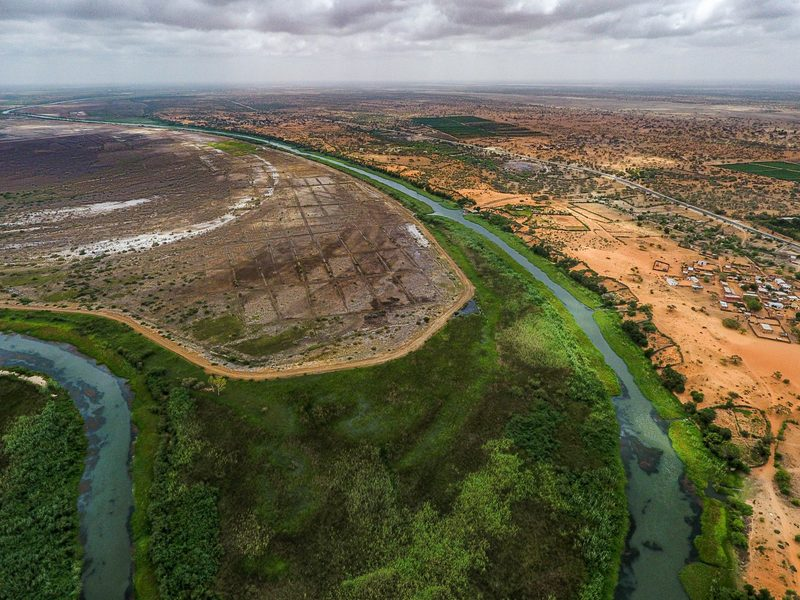</a>
<a href="assets/img/gallery-sen-sunrise.jpg" class="lightbox" data-gallery="field" data-description="Sunrise over rice fields, northern Senegal">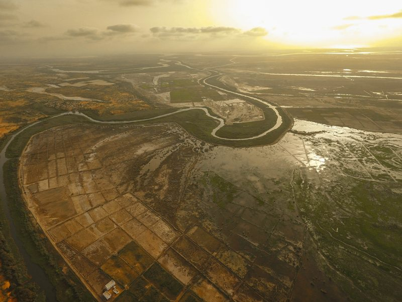</a>
<a href="assets/img/gallery-sen-waterpoint.jpg" class="lightbox" data-gallery="field" data-description="Village water point, Senegal">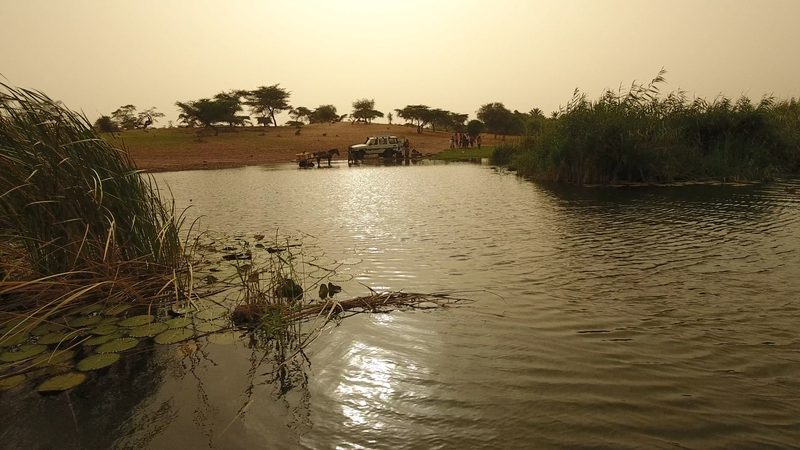</a>
<a href="assets/img/gallery-sen-lilies.jpg" class="lightbox" data-gallery="field" data-description="Water lilies, Senegal">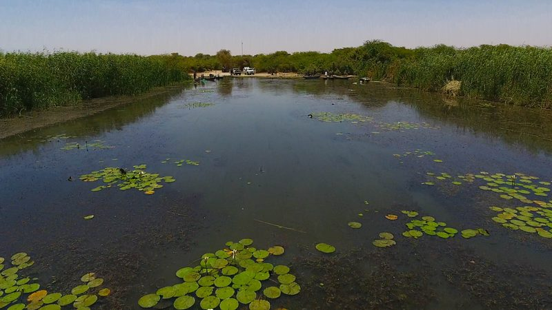</a>
<a href="assets/img/gallery-sen-canal.jpg" class="lightbox" data-gallery="field" data-description="Irrigation canal, Senegal River valley">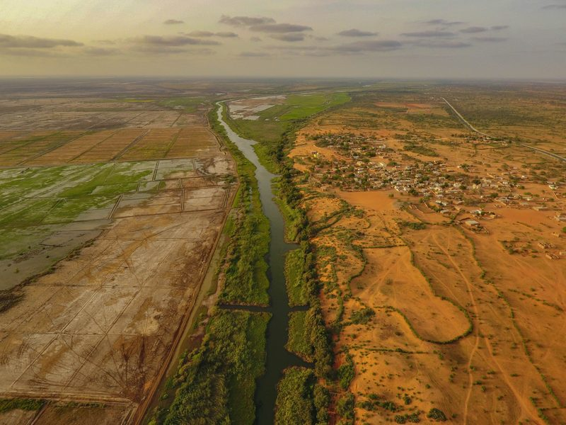</a>
<a href="assets/img/gallery-sen-baobab.jpg" class="lightbox" data-gallery="field" data-description="Baobab and lake, Senegal">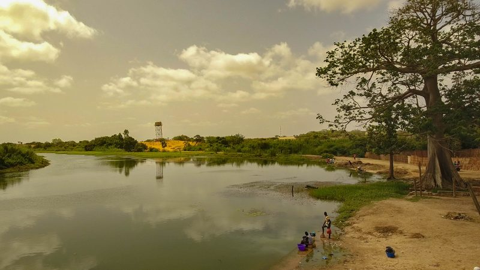</a>
<a href="assets/img/gallery-sen-fields.jpg" class="lightbox" data-gallery="field" data-description="Evening over fields, northern Senegal">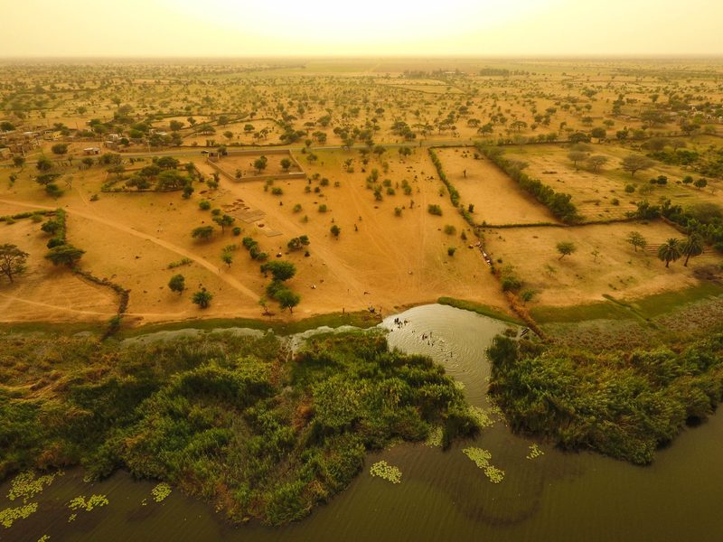</a>
<a href="assets/img/gallery-sen-shore.jpg" class="lightbox" data-gallery="field" data-description="Lake shore, Senegal">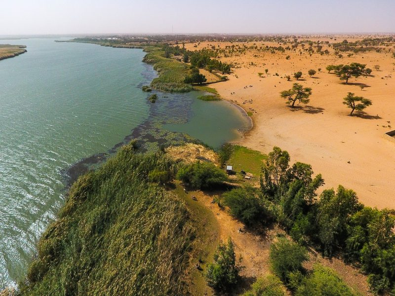</a>
</div>
```

## For fun

Flights in California, Florida and Tennessee.

```{=html}
<div class="photo-grid">
<a href="assets/img/gallery-garrapata.jpg" class="lightbox" data-gallery="fun" data-description="Garrapata, Big Sur">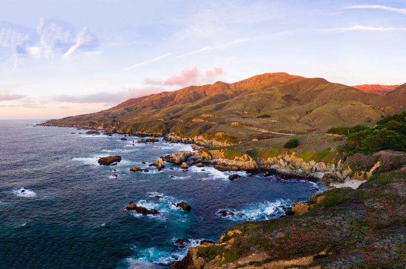</a>
<a href="assets/img/gallery-atlas-peak.jpg" class="lightbox" data-gallery="fun" data-description="Atlas Peak, Napa County">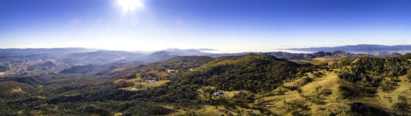</a>
<a href="assets/img/gallery-chico-canyon.jpg" class="lightbox" data-gallery="fun" data-description="Upper Bidwell Park, Chico">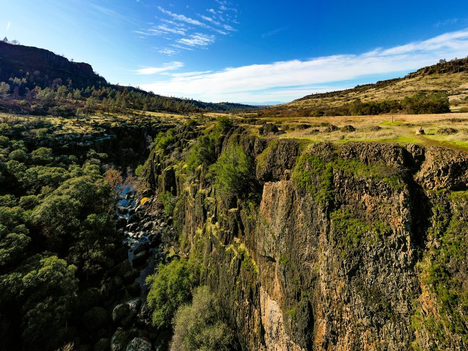</a>
<a href="assets/img/gallery-chico-ridge.jpg" class="lightbox" data-gallery="fun" data-description="Upper Bidwell Park, Chico">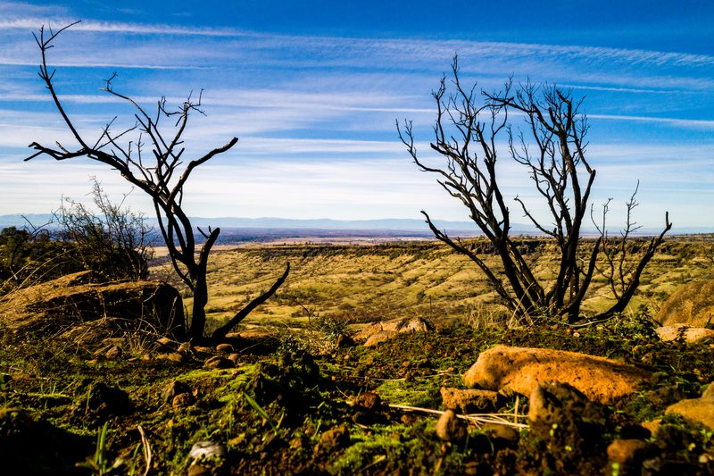</a>
<a href="assets/img/gallery-carmel-sunset.jpg" class="lightbox" data-gallery="fun" data-description="Carmel River Beach">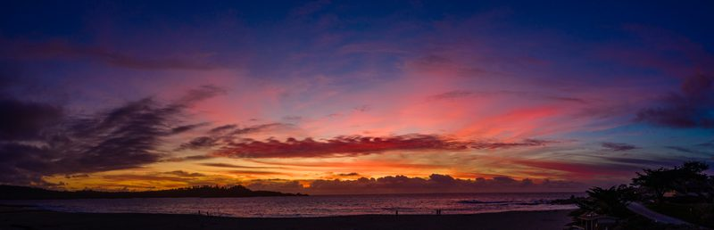</a>
<a href="assets/img/gallery-monteagle-valley.jpg" class="lightbox" data-gallery="fun" data-description="Cumberland Plateau, Tennessee">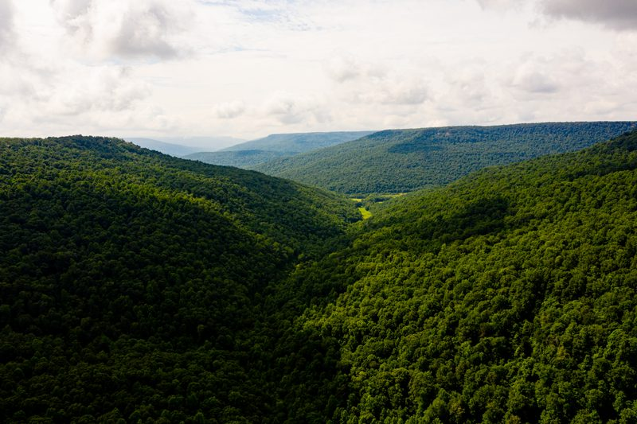</a>
<a href="assets/img/gallery-monteagle-clouds.jpg" class="lightbox" data-gallery="fun" data-description="Cumberland Plateau, Tennessee">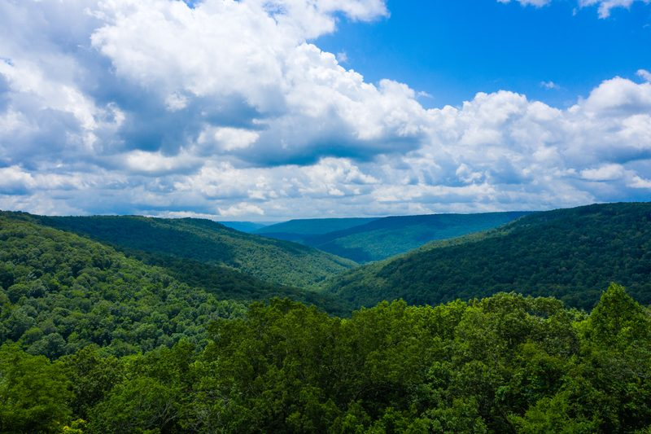</a>
<a href="assets/img/gallery-monteagle-lake.jpg" class="lightbox" data-gallery="fun" data-description="Cumberland Plateau, Tennessee">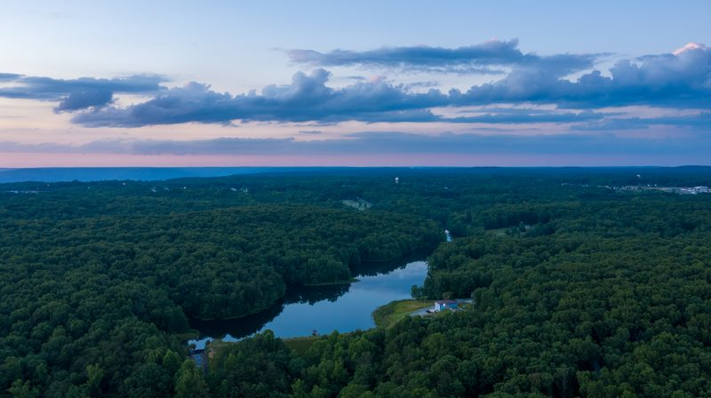</a>
<a href="assets/img/gallery-keys-island.jpg" class="lightbox" data-gallery="fun" data-description="Florida Keys">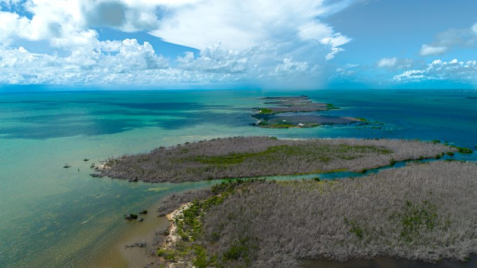</a>
<a href="assets/img/gallery-keys-flats.jpg" class="lightbox" data-gallery="fun" data-description="Florida Keys">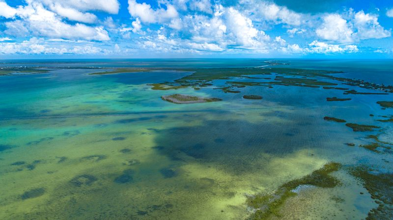</a>
<a href="assets/img/gallery-keys-mangroves.jpg" class="lightbox" data-gallery="fun" data-description="Florida Keys">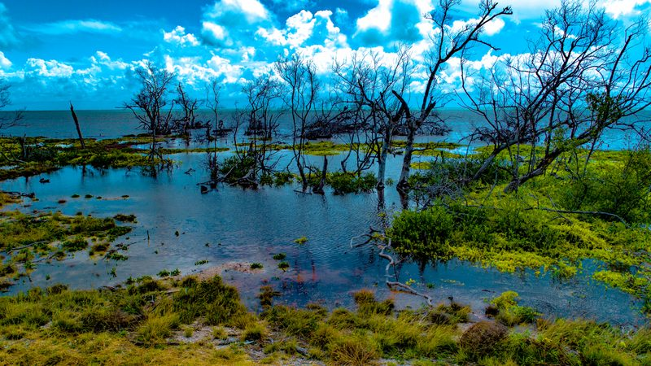</a>
<a href="assets/img/gallery-biscayne-wake.jpg" class="lightbox" data-gallery="fun" data-description="Biscayne Bay, Miami">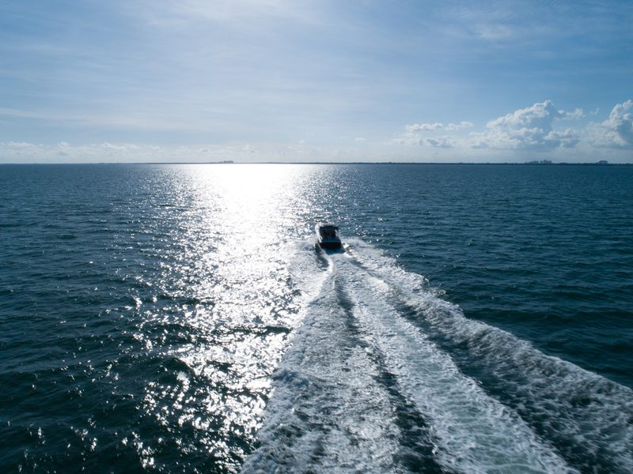</a>
<a href="assets/img/gallery-coconut-grove.jpg" class="lightbox" data-gallery="fun" data-description="Coconut Grove, Miami">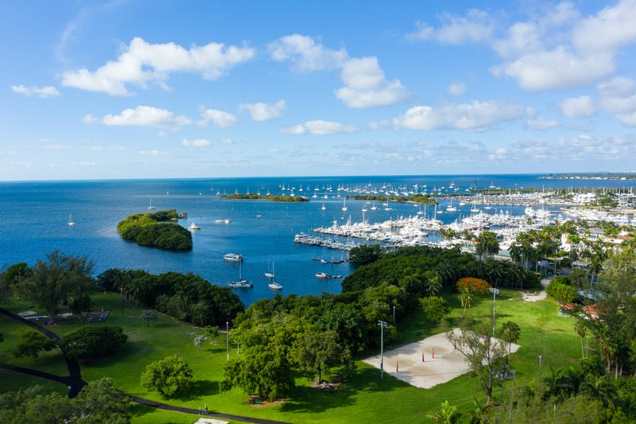</a>
<a href="assets/img/gallery-bucks-lake.jpg" class="lightbox" data-gallery="fun" data-description="Bucks Lake, California">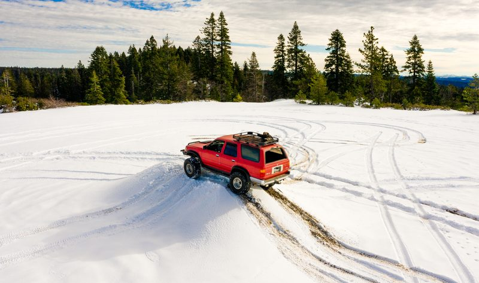</a>
<a href="assets/img/gallery-santa-cruz-mtns.jpg" class="lightbox" data-gallery="fun" data-description="Santa Cruz Mountains">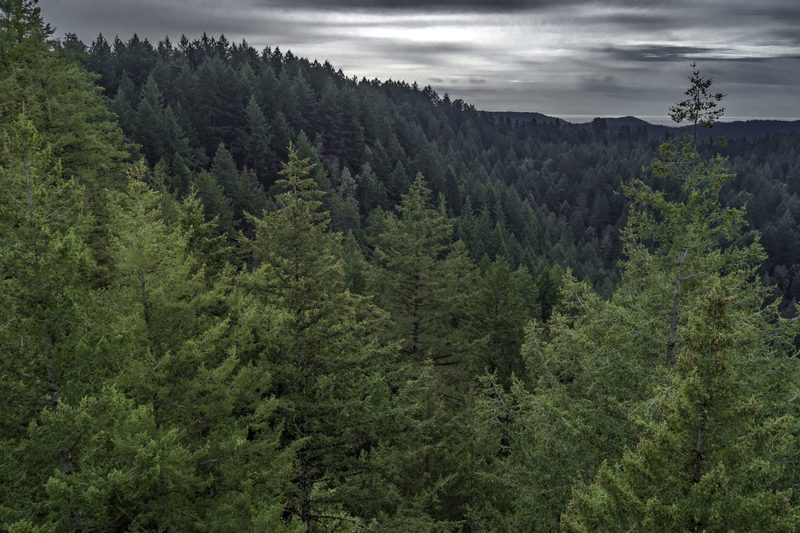</a>
</div>
```
