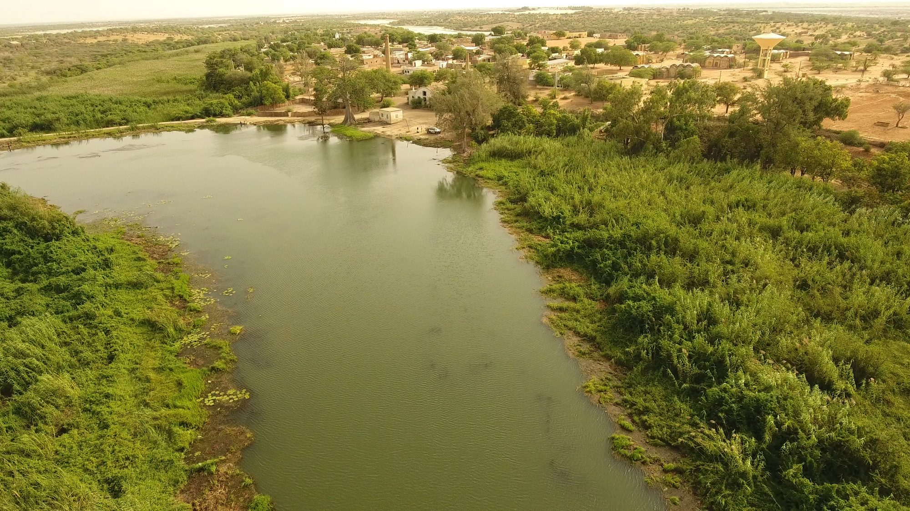
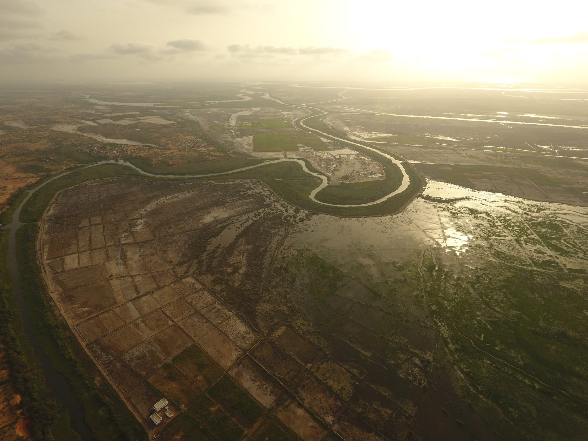
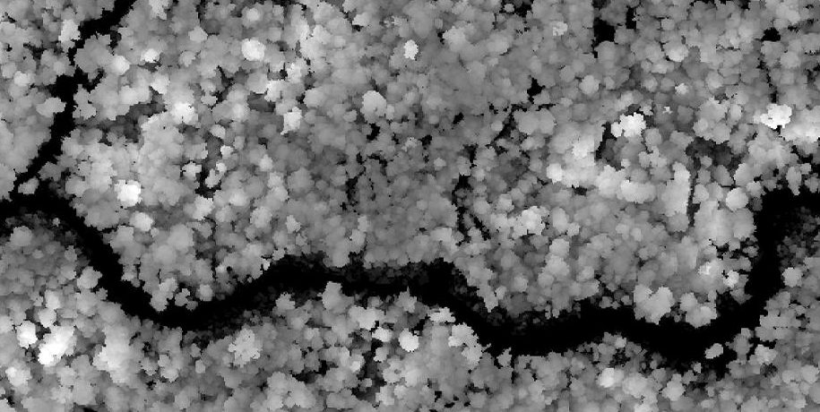
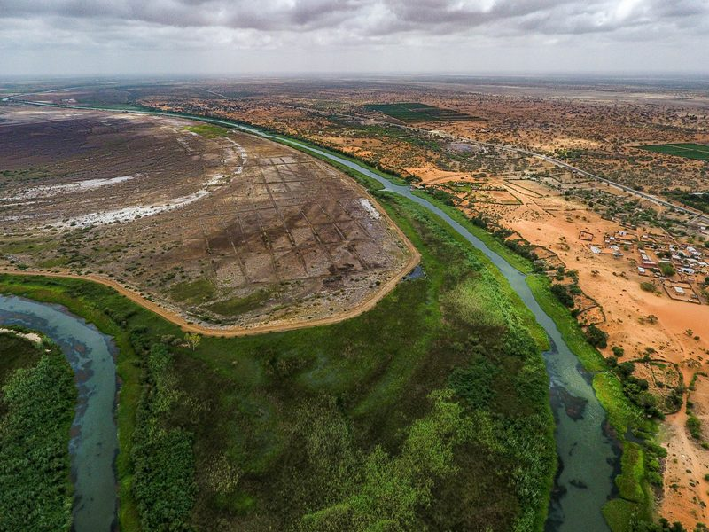
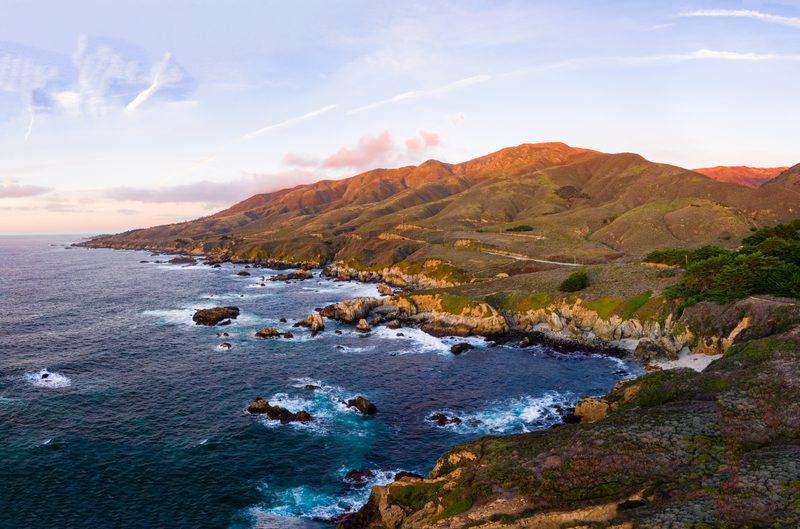
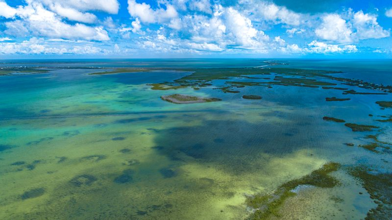

```{=html}
<header class="hero" style="background-image:url('assets/img/banner.jpg')">
  <div class="hero-text">
    <h1>Andy Chamberlin</h1>
    <p>Drone and satellite mapping of landscapes and disease risk.</p>
  </div>
</header>

<section class="intro">
  <p>I'm a research data scientist at Stanford. I use drones, satellites and deep learning to
  map ecological change across landscapes and pinpoint where disease risk is highest. I lead the
  drone and remote sensing work, from study design to finished maps, on projects in Senegal,
  Brazil, Costa Rica, Indonesia and Kenya. I also shoot and edit photo and video in the field.</p>
</section>

<section class="services">
  <div class="service-card">
    <h3>Drone mapping &amp; spatial analysis</h3>
    <p>Mosquito and snail habitat, vegetation and water mapping, crop monitoring, terrain and drainage.</p>
  </div>
  <div class="service-card">
    <h3>Satellite remote sensing &amp; modeling</h3>
    <p>Regional risk maps, habitat and species models, statistical modeling, and scaling drone results up to satellite.</p>
  </div>
  <div class="service-card">
    <h3>Computer vision &amp; deep learning</h3>
    <p>Custom models that find objects and map land cover in drone and satellite images, from labeled examples to finished maps.</p>
  </div>
</section>

<h2 class="section-head">Projects</h2>
<section class="tiles">
  <a class="project-tile" href="projects/senegal-snail-habitat.html">
    
    <h3>Snail habitat, Senegal</h3>
    <p>Mapping the water plants where schistosomiasis snails live along the Senegal River.</p>
  </a>
  <a class="project-tile" href="projects/senegal-rice-fish.html">
    
    <h3>Rice and fish, Senegal</h3>
    <p>Estimating rice yield from drone and satellite imagery in fields stocked with fish.</p>
  </a>
  <a class="project-tile" href="projects/borneo-canopy-height.html">
    
    <h3>Forest canopy height, Borneo</h3>
    <p>Predicting rainforest height across Indonesian Borneo from free satellite data.</p>
    <p class="credit">Image: Chamberlin et al. 2025, CC BY</p>
  </a>
  <a class="project-tile" href="projects/mosquito-breeding-sites.html">
    
    <h3>Mosquito breeding sites</h3>
    <p>Finding discarded tires and trash, where dengue mosquitoes breed, in drone images from Indonesia, Kenya and Costa Rica.</p>
    <p class="credit">Image: Hassan, Chamberlin et al. 2026, CC BY-NC</p>
  </a>
</section>

<section class="media-highlights">
  <h2 class="section-head">In the media</h2>
  <ul>
    <li><a href="https://www.npr.org/2026/07/12/nx-s1-5803170/farmers-fish-rice-snails-tropical-disease">NPR, July 2026: A promising tale from Senegal of fish, rice … and dangerous worms</a></li>
    <li><a href="https://news.stanford.edu/stories/2026/04/mosquito-borne-disease-breeding-sites-drones-ai">Stanford Report, April 2026: Drones and AI take flight to combat mosquito-borne disease</a></li>
    <li><a href="https://news.stanford.edu/stories/2026/03/ai-platform-disease-mapping-schistosomiasis-research">Stanford Report, March 2026: AI platform maps disease risk from space</a></li>
    <li><a href="https://hai.stanford.edu/news/bringing-ai-neglected-tropical-disease">Stanford HAI, March 2020: Bringing AI to a Neglected Tropical Disease</a></li>
  </ul>
  <p><a href="media.html">All media →</a></p>
</section>

<section class="gallery-strip">
  <h2 class="section-head">Photo &amp; video</h2>
  <a href="gallery.html" class="strip-photos">
    
    
    
  </a>
  <p><a href="gallery.html">Drone photos and video from the field and beyond →</a></p>
</section>

<section class="get-in-touch">
  <p>Get in touch: <a class="email" data-u="hello" data-d="andychamberlin.com">email</a></p>
</section>
```
