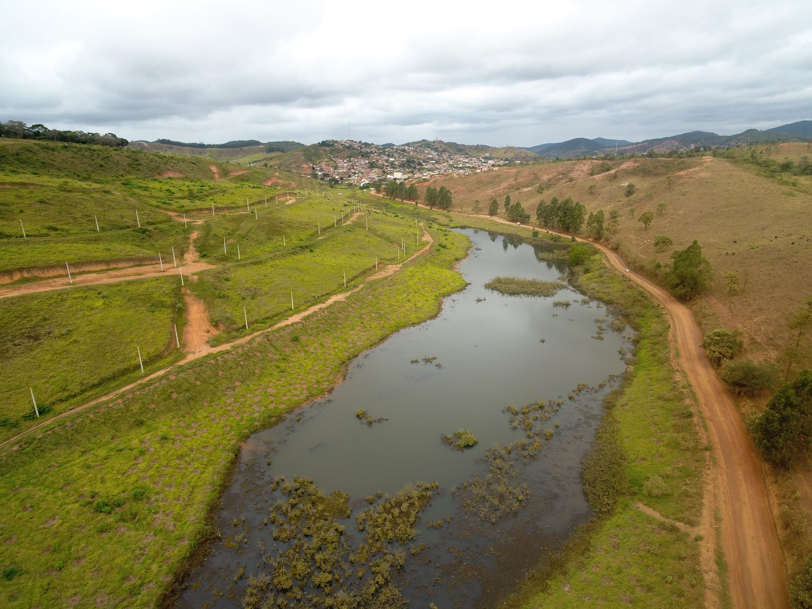
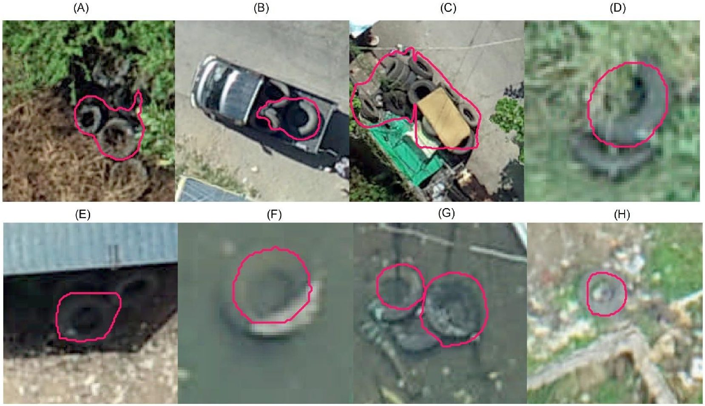

```{=html}
<header class="hero" style="background-image:url('assets/img/banner.jpg')">
  <div class="hero-text">
    <h1>Andy Chamberlin</h1>
    <p>Drone and satellite mapping of landscapes, crops and disease risk.</p>
  </div>
</header>

<section class="intro">
  <p>I'm a research data scientist at Stanford. I map where disease-carrying snails and
  mosquitoes live, and how crops and water change across a landscape, from drone flights up to
  satellite imagery. My work spans Senegal, Brazil, Costa Rica, Indonesia and Kenya, and I also
  shoot and edit photo and video from the field.</p>
</section>

<section class="services">
  <div class="service-card">
    <h3>Drone mapping &amp; spatial analysis</h3>
    <p>Mosquito and snail habitat, crop health and yield, vegetation and water mapping.</p>
  </div>
  <div class="service-card">
    <h3>Satellite remote sensing &amp; modeling</h3>
    <p>Regional risk maps, habitat and species models, and scaling drone results up to satellite.</p>
  </div>
</section>

<h2 class="section-head">Projects</h2>
<section class="tiles">
  <a class="project-tile" href="projects/senegal-snail-habitat.html">
    
    <h3>Snail habitat, Senegal</h3>
    <p>Mapping the water plants where schistosomiasis snails live along the Senegal River.</p>
  </a>
  <a class="project-tile" href="projects/senegal-rice-fish.html">
    
    <h3>Rice and fish, Senegal</h3>
    <p>Estimating rice yield from drone and satellite imagery in fields stocked with fish.</p>
  </a>
  <a class="project-tile" href="projects/brazil-snail-habitat.html">
    
    <h3>Snail habitat, Brazil</h3>
    <p>Drone surveys of ponds and streams where schistosomiasis is spread.</p>
  </a>
  <a class="project-tile" href="projects/indonesia-tire-detection.html">
    
    <h3>Tire detection, Indonesia</h3>
    <p>Finding discarded tires, where dengue mosquitoes breed, in drone images of a city.</p>
  </a>
</section>

<section class="media-highlights">
  <h2 class="section-head">In the media</h2>
  <ul>
    <li><a href="https://www.npr.org/2026/07/12/nx-s1-5803170/farmers-fish-rice-snails-tropical-disease">NPR, July 2026: A promising tale from Senegal of fish, rice … and dangerous worms</a></li>
    <li><a href="https://news.stanford.edu/stories/2026/03/ai-platform-disease-mapping-schistosomiasis-research">Stanford Report, March 2026: AI platform maps disease risk from space</a></li>
    <li><a href="https://news.stanford.edu/stories/2026/01/schistosomiasis-river-fever-transmission-research">Stanford Report, January 2026: Researchers work to outrun the risk of ‘river fever’</a></li>
  </ul>
  <p><a href="media.html">All media →</a></p>
</section>

<section class="get-in-touch">
  <p>Get in touch: <a class="email" data-u="hello" data-d="andychamberlin.com">email</a></p>
</section>
```
