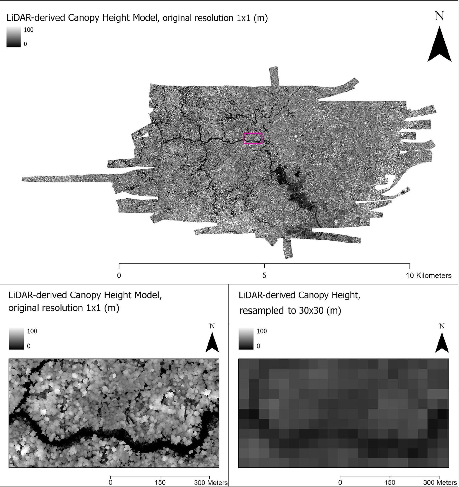

Canopy height is a good guide to how much carbon a forest holds and where it is being
degraded. Measuring it usually takes airborne lidar, which is costly and covers only narrow
strips.

I led a project that trained a deep learning model on lidar from 85 sites across Indonesian
Borneo, paired with free satellite and terrain data. The model can predict canopy height at
30 m across Kalimantan wherever lidar is missing, and it was more accurate than the tree-based
methods common in the field.

::: {.gallery}
{fig-alt="Lidar canopy height maps of a Borneo forest block at 1 m resolution and resampled to 30 m"}
:::

**Forest loss.** Building on the canopy height model, I mapped forest loss around villages in
West Kalimantan for a study of how health care and livelihood programs held up during the
pandemic.

**Papers:** [Chamberlin et al. 2025, *Remote Sensing*](https://doi.org/10.3390/rs17213592) ·
[Hopkins et al. 2026, *The Lancet Planetary Health*](https://doi.org/10.1016/j.lanplh.2026.101455)

**News:** [Stanford Woods Institute, July 2026](https://woods.stanford.edu/news/community-led-health-and-livelihood-programs-helped-protect-rainforests-during-pandemic)

Figures from Chamberlin et al. 2025, CC BY 4.0.
