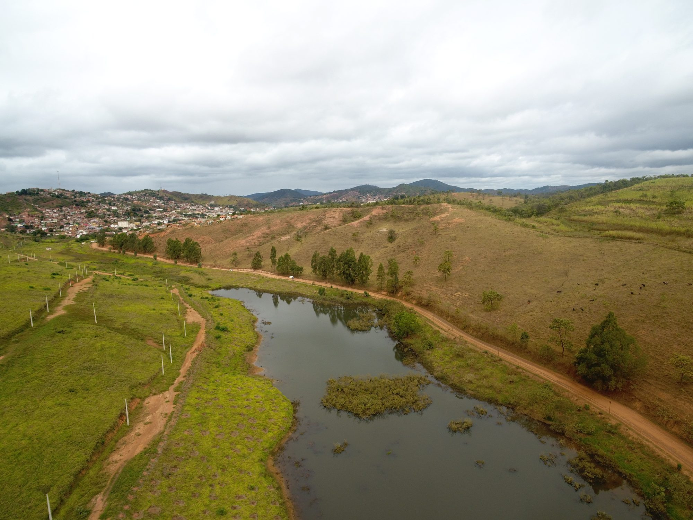
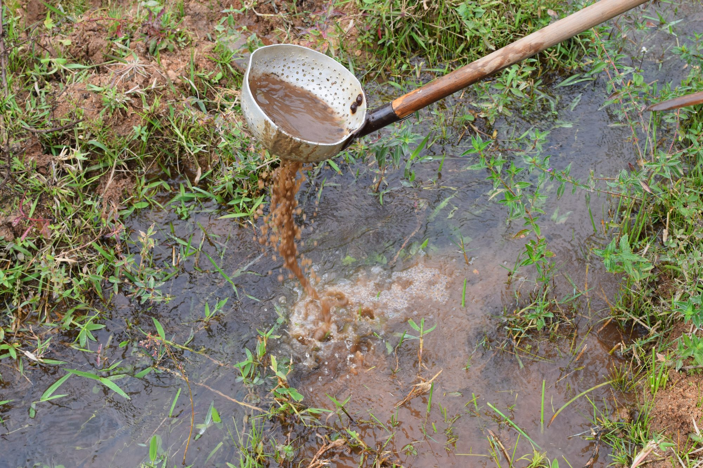

::: {.gallery}
{fig-alt="Drone view of a pond and stream below a small town in southeastern Brazil"}
:::

In July and August 2019 I flew drone surveys of ponds, streams and pastures at schistosomiasis
study sites in southeastern Brazil, alongside snail sampling on the ground.

The wider Brazil work maps where the snails can live across the country, and how climate and
growing cities are shifting that range, using satellite data and species models.

::: {.gallery}
{fig-alt="Scooping a stream edge for freshwater snails in Brazil"}
:::

**Papers:** [Glidden et al. 2024, *Nature Communications*](https://doi.org/10.1038/s41467-024-48335-9) ·
[Singleton et al. 2024, *PLOS Global Public Health*](https://doi.org/10.1371/journal.pgph.0002224) ·
[da Silva et al. 2024, *PLOS NTD*](https://doi.org/10.1371/journal.pntd.0012582)
