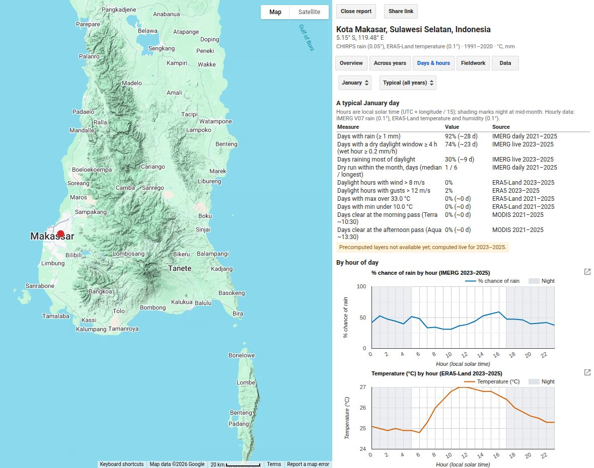
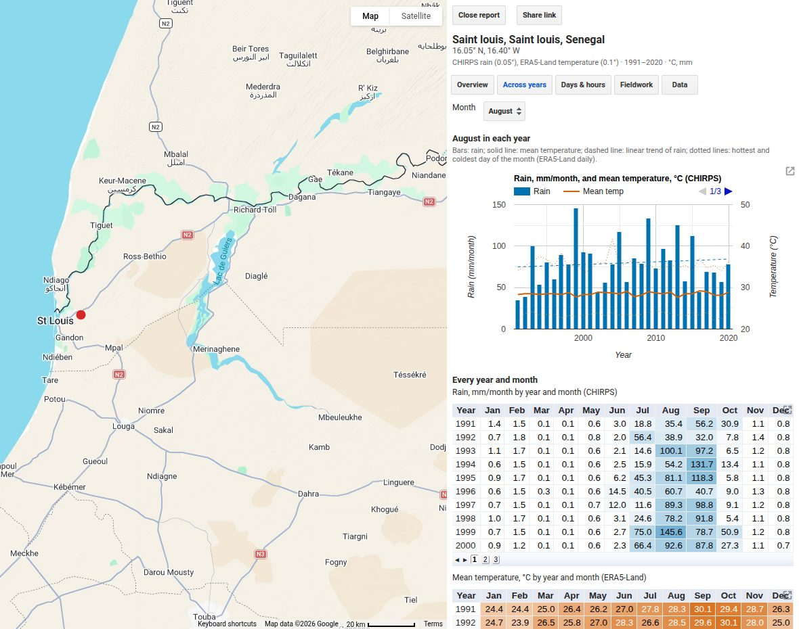
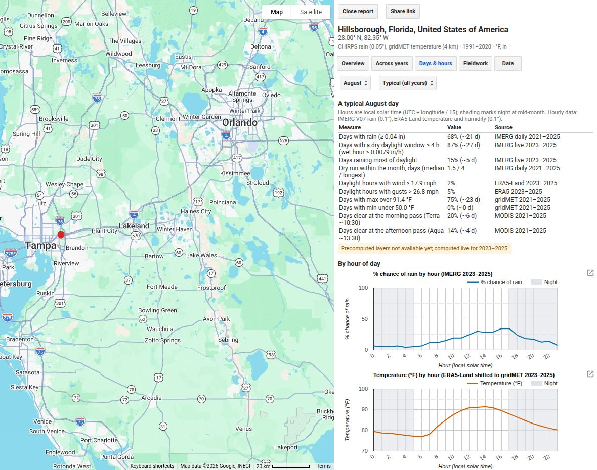

<a class="app-button" href="https://ee-andychamberlin.projects.earthengine.app/view/climate-explorer">Open Climate Explorer</a>

Click a point or draw an area anywhere on land, and Climate Explorer shows what the weather is
like there: rain, heat, wind and the odds of a clear sky when satellites pass over. You can
look by month, across years, by day of the month and by hour of the day.

I built it to plan fieldwork. Monthly totals tell you January is wet in Makassar, but not
whether a typical January day leaves a few dry daylight hours for mosquito larval sampling or
a drone flight. Hourly satellite rainfall answers that: in 2023–2025, rain fell on about nine
January days in ten, yet three days in four still had a dry daylight window of four hours or
more.

## Try it

- [Makassar, Indonesia, in January](https://ee-andychamberlin.projects.earthengine.app/view/climate-explorer#lat=-5.15;lon=119.48;m=1;tab=days;):
  a typical day, hour by hour
- [Saint-Louis, Senegal, in August](https://ee-andychamberlin.projects.earthengine.app/view/climate-explorer#lat=16.05;lon=-16.4;m=8;tab=years;):
  rainy-season rain year by year
- [Tampa Bay, Florida, in August](https://ee-andychamberlin.projects.earthengine.app/view/climate-explorer#lat=28;lon=-82.35;m=8;u=i;tab=days;):
  the afternoon thunderstorm peak, in °F

Some views compute when you ask for them and take about 30 seconds.

::: {.gallery}
{fig-alt="Climate Explorer at Makassar in January: a table of rain, dry-window, wind, heat and clear-sky odds, and charts of rain chance and temperature by hour"}

{fig-alt="Climate Explorer at Saint-Louis, Senegal: August rain and temperature in each year, with a table of rain by year and month"}

{fig-alt="Climate Explorer at Tampa in August: rain chance peaking in the afternoon and temperature by hour, in Fahrenheit"}
:::

## Data and limits

- **Rain:** CHIRPS (0.05°, about 5 km) for monthly totals and IMERG V07 (0.1°) for daily and
  hourly rain. CHIRPS covers 50°S–50°N; outside that band, rain comes from ERA5-Land.
- **Temperature, humidity and wind:** ERA5-Land (0.1°), with gusts from ERA5 (0.25°). In the
  contiguous US, daily temperature comes from gridMET (4 km), which is calibrated to weather
  stations. Elsewhere ERA5-Land can run a few degrees cool on daily highs in hot, humid places.
- **Clear sky:** MODIS cloud state at the morning (Terra, about 10:30) and early afternoon
  (Aqua, about 13:30) passes, at 1 km, over the last five years.
- **Long-term averages:** 1991–2020. TerraClimate (about 4 km) is an optional source for
  monthly temperature.
- A clicked point reads one grid cell, about 10 km across for most layers, not a weather
  station. A drawn area reports the average over its pixels. Every view names its dataset,
  resolution, years and units.
- This is climate and recent history, not a forecast.
- Precomputed layers are filling in through December 2026. Until they're done, dry-window and
  wind numbers compute when you ask, one month at a time.

## Credits

Data: CHIRPS (Climate Hazards Center, UC Santa Barbara); IMERG (NASA Global Precipitation
Measurement); ERA5 and ERA5-Land (ECMWF, Copernicus Climate Change Service); gridMET and
TerraClimate (Climatology Lab); MODIS (NASA). Contains modified Copernicus Climate Change
Service information 2026. Runs on Google Earth Engine; map data © Google.
