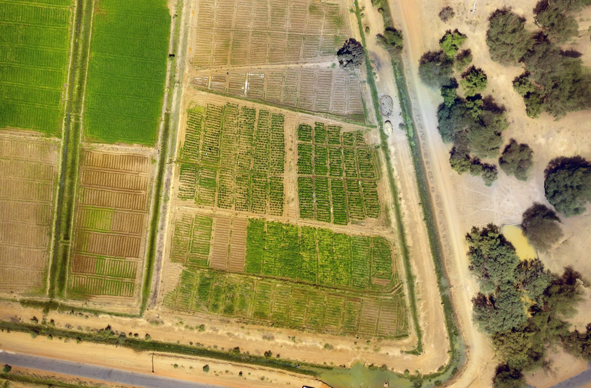
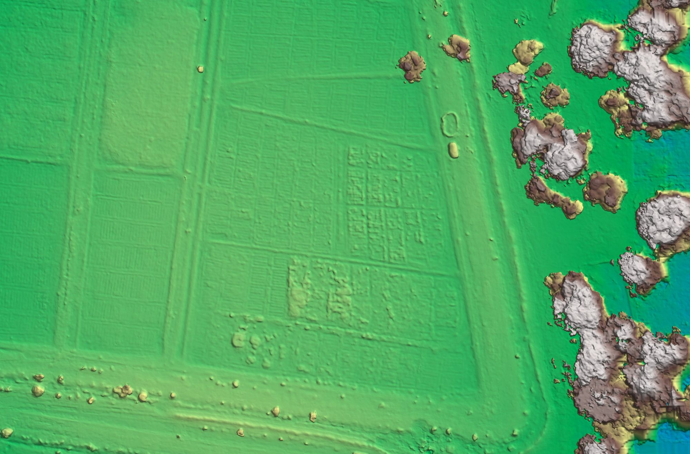
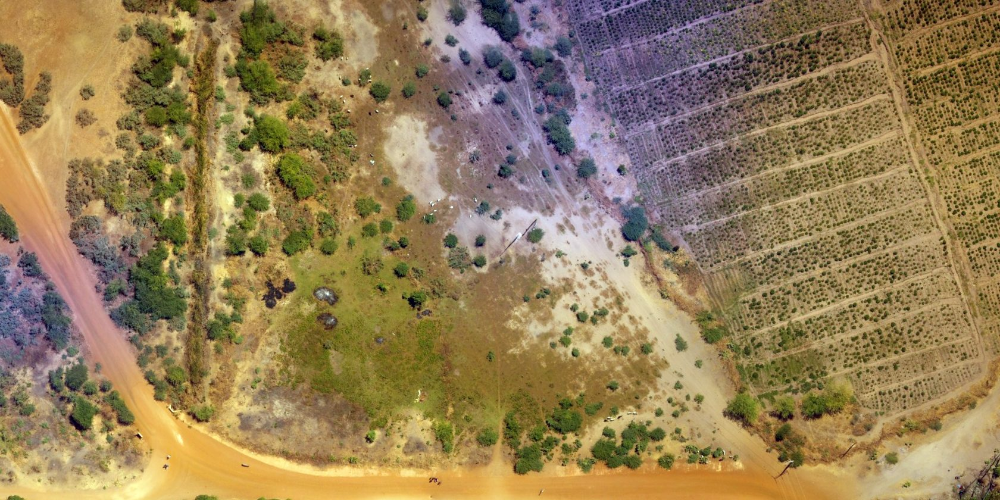
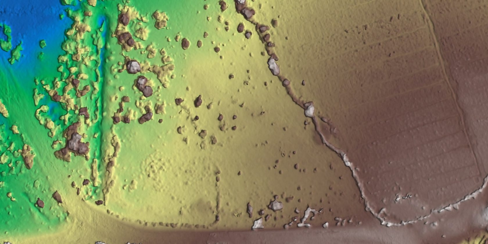

Every layer lines up on the same ground. Drag the slider to compare the orthomosaic (left) with
a layer (right); the buttons switch layers.

Senegal River valley, 2022. Flown on a scoping trip for our schistosomiasis work with a DJI
Phantom 4 (color) and a MAPIR Survey3 OCN camera (orange, cyan and near-infrared), and processed
with OpenDroneMap. These sites were not part of the study.

## Irrigated gardens and trees

```{=html}
<div class="compare-wrap">
<div class="layer-tabs" role="group" aria-label="Layer to compare">
  <button type="button" aria-pressed="true" data-src="../assets/img/dp-a-dsm.jpg" data-alt="Shaded surface model of the same fields: plot edges, berms and tree crowns in relief" data-caption="Surface model: height of the ground and everything on it, shaded so relief stands out. Heights are relative; these flights had no RTK.">Surface model</button>
  <button type="button" aria-pressed="false" data-src="../assets/img/dp-a-chm.jpg" data-alt="Vegetation height of the same fields: trees in dark green against flat ground" data-caption="Vegetation height: the surface model minus the bare-earth terrain model, 0 to 4 m. Trees and shrubs stand out from fields and ground.">Vegetation height</button>
  <button type="button" aria-pressed="false" data-src="../assets/img/dp-a-ocn.jpg" data-alt="Vegetation index of the same fields: green crop plots, red bare ground and road" data-caption="Vegetation index: near-infrared against orange from the Survey3 OCN camera. Greener means more vigorous plants; values are relative.">Vegetation index</button>
</div>
<div class="compare">
  
  <div class="compare-top"></div>
  <input type="range" min="0" max="100" value="50" aria-label="Drag to compare the orthomosaic with the selected layer">
</div>
<p class="layer-caption">Surface model: height of the ground and everything on it, shaded so relief stands out. Heights are relative; these flights had no RTK.</p>
</div>
```

## Planted rows, scrub and a drainage line

```{=html}
<div class="compare-wrap">
<div class="layer-tabs" role="group" aria-label="Layer to compare">
  <button type="button" aria-pressed="true" data-src="../assets/img/dp-b-dsm.jpg" data-alt="Shaded surface model of the same area: the land sloping toward the drainage line, with trees in relief" data-caption="Surface model: height of the ground and everything on it, shaded so relief stands out. Heights are relative; these flights had no RTK.">Surface model</button>
  <button type="button" aria-pressed="false" data-src="../assets/img/dp-b-chm.jpg" data-alt="Vegetation height of the same area: individual trees and shrubs in green" data-caption="Vegetation height: the surface model minus the bare-earth terrain model, 0 to 4 m. Trees and shrubs stand out from fields and ground.">Vegetation height</button>
  <button type="button" aria-pressed="false" data-src="../assets/img/dp-b-ocn.jpg" data-alt="Vegetation index of the same area: trees in dark green, the road in red" data-caption="Vegetation index: near-infrared against orange from the Survey3 OCN camera. Greener means more vigorous plants; values are relative.">Vegetation index</button>
</div>
<div class="compare">
  
  <div class="compare-top"></div>
  <input type="range" min="0" max="100" value="50" aria-label="Drag to compare the orthomosaic with the selected layer">
</div>
<p class="layer-caption">Surface model: height of the ground and everything on it, shaded so relief stands out. Heights are relative; these flights had no RTK.</p>
</div>
```

## What's delivered

- **Orthomosaic:** a georeferenced image of the whole site at 2 to 3 cm per pixel. The pictures
  here are reduced for the web.
- **Surface and terrain models:** elevation with and without vegetation and buildings, for
  drainage, standing water and earthworks. With RTK positioning these reach centimeter accuracy.
- **Vegetation height and indices:** canopy height, plant vigor, and the basis for habitat maps.
- **Files:** GeoTIFFs in the coordinate system you work in, ready for QGIS or ArcGIS, with a short
  guide to each layer.

Newer surveys with a Mavic 3 Multispectral and RTK, in Costa Rica and Indonesia, add
centimeter-accurate heights and calibrated multispectral bands. Examples will go here once that
work is published.
