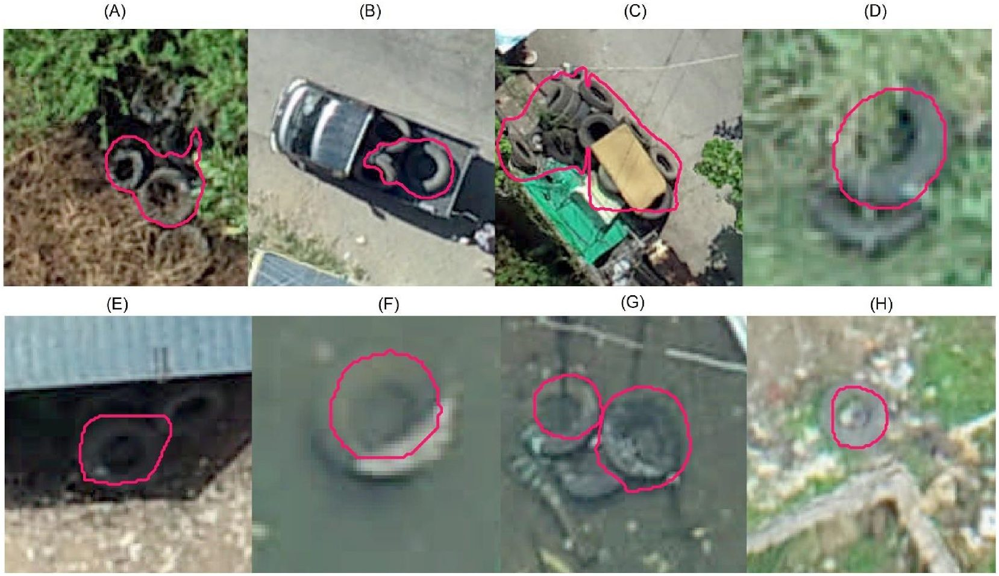
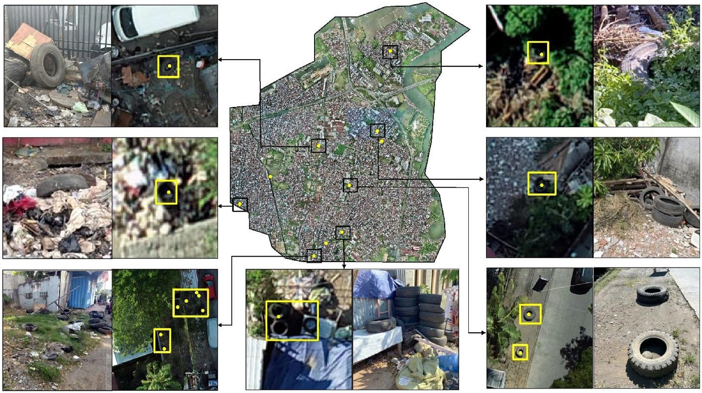

::: {.gallery}
{fig-alt="Tires outlined in red on drone images of Makassar, Indonesia"}
:::

Discarded tires collect rainwater and are some of the most productive breeding sites for the
mosquito that spreads dengue. Finding them on foot across a city takes weeks.

Working from drone imagery of Makassar, we trained a computer model to find tires
automatically and mapped where they cluster across neighborhoods. I handle the imagery from raw
drone photos onward. The same approach is being tested on trash sites in Kenya.

::: {.gallery}
{fig-alt="Drone map of Makassar with ground photos of tires and trash sites"}
:::

**Papers:** [Hassan, Chamberlin et al. 2026, *Remote Sensing Applications: Society and Environment*](https://doi.org/10.1016/j.rsase.2026.102011) ·
[Woo et al. 2026, *Parasites & Vectors*](https://doi.org/10.1186/s13071-026-07646-0)

Figures from Hassan, Chamberlin et al. 2026, CC BY-NC.
