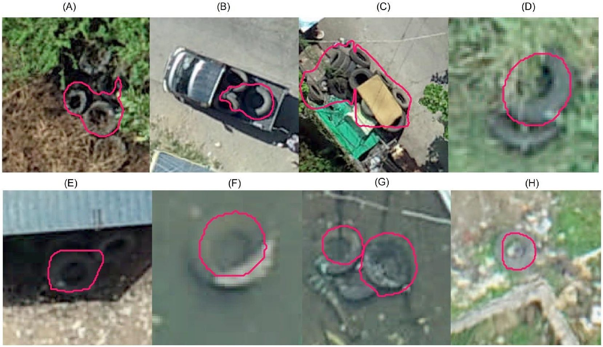
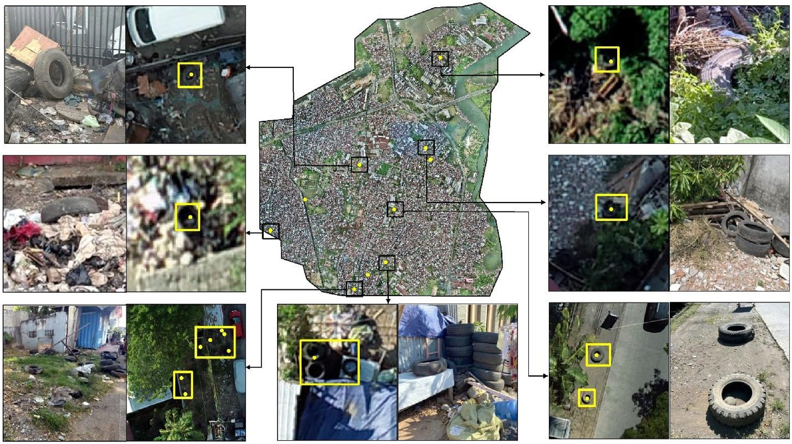

::: {.gallery}
{fig-alt="Pile of tires outlined in red in a drone image of Makassar, Indonesia"}
:::

Discarded tires and trash collect rainwater and are some of the most productive breeding sites
for the mosquito that spreads dengue. Finding them on foot across a town takes weeks.

- **Indonesia:** I trained the deep learning model that finds tires in drone imagery of
  Makassar, and I take the imagery from raw drone photos to finished maps. I'm now building
  the next model, which sorts trash piles into types as well as finding tires.
- **Kenya:** the same group built a way to spot trash piles and tires in drone images and
  checked it against surveys on foot.
- **Costa Rica:** I planned drone flights in two regions and lead the analysis: testing whether
  my tire model works in towns it was never trained on, and scaling drone maps up to satellite
  imagery.

::: {.gallery}
{fig-alt="Drone map of Makassar with ground photos of tires and trash sites"}
:::

**Papers:** [Hassan, Chamberlin et al. 2026, *Remote Sensing Applications: Society and Environment*](https://doi.org/10.1016/j.rsase.2026.102011) ·
[Woo et al. 2026, *Parasites & Vectors*](https://doi.org/10.1186/s13071-026-07646-0) ·
[Tarpenning et al. 2025, *Parasites & Vectors*](https://doi.org/10.1186/s13071-025-06706-1) ·
[Rosser et al. 2024, *Environmental Science and Pollution Research*](https://doi.org/10.1007/s11356-024-33801-0) ·
[Bramante et al. 2026, *BMC Global and Public Health*](https://doi.org/10.1186/s44263-026-00250-5)

Figures from Hassan, Chamberlin et al. 2026, CC BY-NC.
