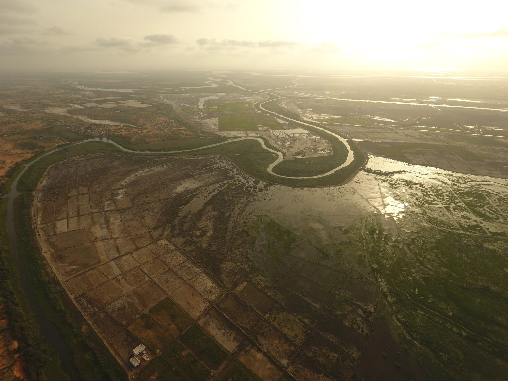

::: {.gallery}
{fig-alt="Irrigated fields along a channel in the Senegal River valley at sunrise"}
:::

Farmers in the Senegal River valley are testing fish in their rice fields: the fish eat the
snails that carry schistosomiasis and can add income. The question for farmers is whether rice
yield holds up.

I use drone and satellite imagery from the 2025 season to estimate yield field by field and to
spot problems such as weeds, bare patches and uneven water. Partners in Senegal fly the drone
surveys; I process the imagery and build the yield estimates, using deep learning to measure
plant cover and problem areas in each field. Results will be shared once
they're published.

**News:** [NPR, July 2026](https://www.npr.org/2026/07/12/nx-s1-5803170/farmers-fish-rice-snails-tropical-disease) ·
[Stanford Report, January 2026](https://news.stanford.edu/stories/2026/01/schistosomiasis-river-fever-transmission-research)
