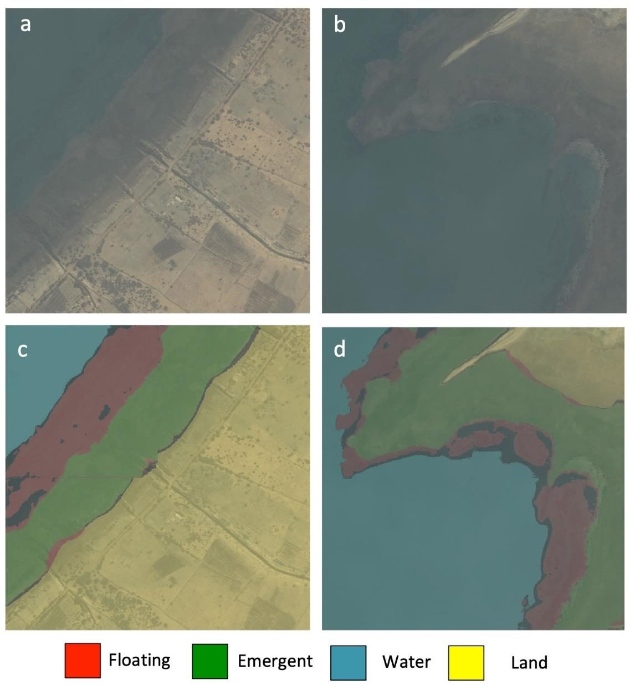

Dams and irrigation along the Senegal River changed its water and fed the plants that
schistosomiasis snails live in. Surveys on foot reach only a few sites; the risk spreads across
the whole basin.

We built a deep learning model that maps floating plants, rooted plants, open water and land
from high-resolution satellite images, using drone maps and field surveys to teach it what each
looks like from above. I helped build, train and test the model, organized the image data,
labeled the training maps and led the drone mapping behind them. The approach grew into an AI
platform for mapping schistosomiasis risk from space.

::: {.gallery}
{fig-alt="Two satellite images of the Senegal River basin and the model's maps of floating plants, rooted plants, water and land"}
:::

**Papers:** [Liu et al. 2022, *Remote Sensing*](https://doi.org/10.3390/rs14061345)

**News:** [Stanford HAI, March 2020](https://hai.stanford.edu/news/bringing-ai-neglected-tropical-disease) ·
[Stanford Report, March 2026](https://news.stanford.edu/stories/2026/03/ai-platform-disease-mapping-schistosomiasis-research) ·
[Stanford HAI, March 2026](https://hai.stanford.edu/news/how-a-hai-seed-grant-helped-launch-a-disease-fighting-ai-platform)

Figure from Liu et al. 2022, CC BY; satellite imagery © Maxar Technologies.
