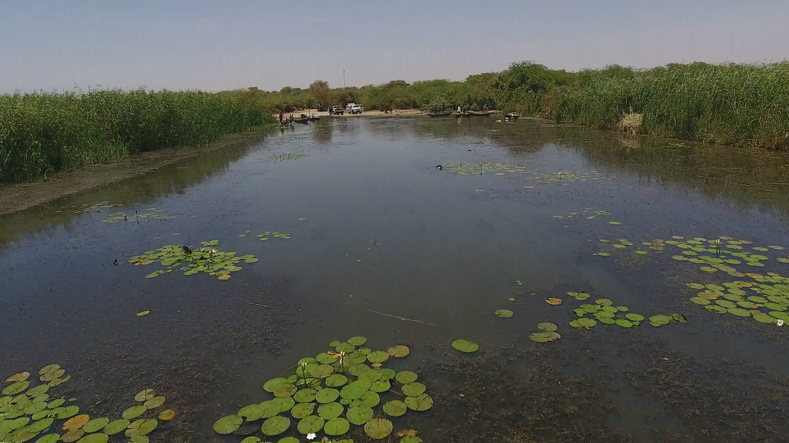

::: {.gallery}
{fig-alt="Open water with floating lily pads at a schistosomiasis study site in Senegal"}
:::

Schistosomiasis spreads through freshwater snails that shelter in water plants. Since 2016 I
have led drone mapping at village water sites along the lower Senegal River, flying the early
surveys and later training local partners to fly them. The maps show how much of each site is
open water and how much is covered by plants.

That plant cover turned out to predict how many children were infected better than counting
snails did. It now guides where to remove plants and where to look for transmission.

Mapping plants by hand at every site doesn't scale, so I'm building deep learning models that
outline open water and floating and rooted plants in each drone map.

**Papers:** [Wood et al. 2019, *PNAS*](https://doi.org/10.1073/pnas.1903698116) ·
[Chamberlin et al. 2021, *Geospatial Health*](https://doi.org/10.4081/gh.2020.818) ·
[Jones et al. 2021, *PLOS NTD*](https://doi.org/10.1371/journal.pntd.0009712) ·
[Liu et al. 2022, *Remote Sensing*](https://doi.org/10.3390/rs14061345)

**News:** [Stanford Report, March 2026](https://news.stanford.edu/stories/2026/03/ai-platform-disease-mapping-schistosomiasis-research)
