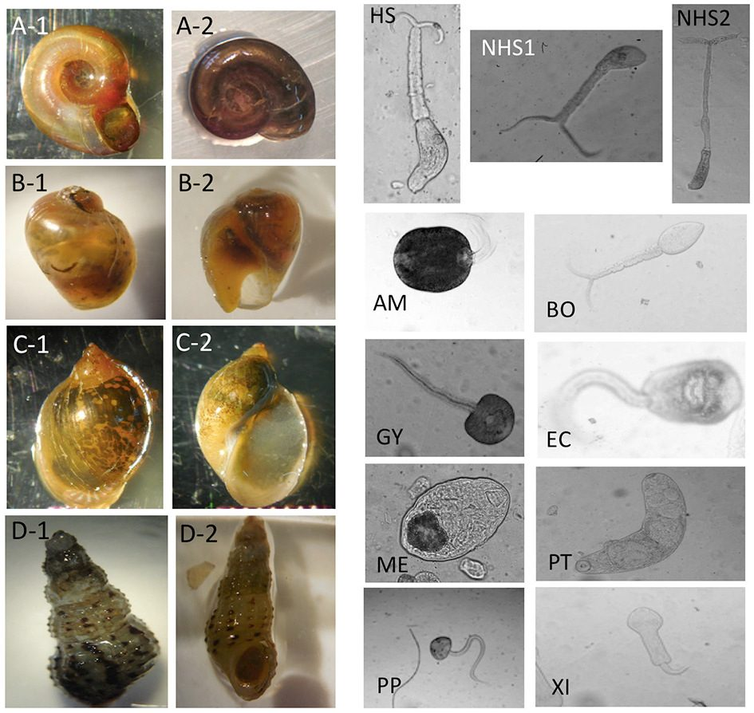

Schistosomiasis surveys depend on telling snail species apart, and on spotting the human
parasite among the many look-alike larvae that snails release. Both take trained experts,
who are scarce in the places that need them.

I co-developed deep learning models that identify medically important snails and
parasite larvae from microscope and field photos taken in Senegal. They performed about as well
as experienced parasitologists, and the labeled images were released for others to use.

::: {.gallery}
{fig-alt="Example photos of four snail groups and eleven kinds of parasite larvae from the training images"}
:::

I'm now leading a new version with the De Leo lab, adding snails from Côte d'Ivoire and Brazil.

**Papers:** [Tallam et al. 2021, *Frontiers in Public Health*](https://doi.org/10.3389/fpubh.2021.642895)

Figure from Tallam et al. 2021, CC BY.
